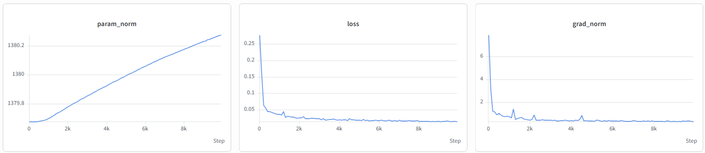

# Robotic Arm VLA Pipeline

A simulator-agnostic end-to-end training/inference pipeline, including converting robotic manipulation trajectories into **LeRobot** format, publishing datasets to **Hugging Face**, fine-tuning **π₀/π₀.₅ (`openpi`)** Vision-Language-Action (VLA) models, and executing closed-loop inference.

## Dataset

Download Dataset: https://huggingface.co/datasets/wasil11/Franka-FR3-Unity3d-Simulation-Ball-Pick-And-Place

## Results

### Training Results

The model was trained for 10K iterations.

| Model | Mode | GPU/Memory/Disk Requirement | Training Duration | Hugging Face Model Download link | Loss Curve |
| --- | :---: | --- | --- | --- |--- |
| π₀ | Fine-Tuning (LoRA) | **RTX 4090, 22 GiB VRAM, 50 GB Disk Space**  | 3.5 Hours | https://huggingface.co/wasil11/pi0-franka-fr3-pick-and-place-lora | 
| π₀ | Fine-Tuning (Full) | - | In Progress | - | - |
| π₀.₅ | Fine-Tuning (LoRA) | - | - | - | - |
| π₀.₅ | Fine-Tuning (Full) | - | --- | - | - |

### Inference Results
| Model | Mode | GPU/Memory/Disk Requirement | Inference Attempts |
| --- | :---: | --- | --- |
| π₀ | Inference (LoRA) | **RTX 4090, 11 GiB VRAM, 50 GB Disk Space** | <video controls src="media/pi0_lora_finetuning_inference_01.mp4" title="pi0-LoRA-Finetuning-pick-and-place-inference"></video> |
| π₀ | Inference (Full) | - | - |
| π₀.₅ | Inference (LoRA) | - | - |
| π₀.₅ | Inference (Full) | - | - |


## Setup and Usage 

### Convert Raw Trajectories to LeRobot & Push to Hugging Face
To Convert synchronized multi-camera frames and 8-DOF joint state/action trajectories from Unity3D into LeRobot v2.1 format:

```bash
poetry run python scripts/1_convert_to_lerobot.py \
  --data_dir "DATA_PATH/dataset_fr3_pick_place" \
  --repo_id "wasil11/Franka-FR3-Unity3d-Simulation-Ball-Pick-And-Place"
  --robot_type "franka_fr3"
```

### Closed-Loop Training and Inference Guide (Cloud GPU + Local Windows Unity)

#### Part 1: Cloud GPU Server (Linux / Vast.ai)

1. Clone Repository & Install Dependencies in your server where you want to train and inference your VLA architecture
```bash
cd /workspace
git clone git@github.com:MohammadWasil/Finetuning-pi0-Franka-FR3-Robotic-Arm-Pipeline.git
cd Finetuning-pi0-Franka-FR3-Robotic-Arm-Pipeline
bash installation.sh
source .venv/bin/activate
```

2. Authenticate with Hugging Face (required as we are downloading/uploading the model/data to/from (private) hugggingface repo)
```bash
huggingface-cli login
```

3. Compute normalization statistics (Only once per data)
```bash
cd third_party/openpi
python scripts/compute_norm_stats.py --config-name pi0_fr3_unity_low_mem_finetune
```

4. Fine-tune π₀ (add WANDB_MODE=disabled if not logging into W&B)
```bash
XLA_PYTHON_CLIENT_MEM_FRACTION=0.9 python scripts/train.py pi0_fr3_unity_low_mem_finetune --exp-name=fr3_pick_place --overwrite
```

5. Download Checkpoint (if not already) & Launch the WebSocket Policy Server (Port 8000)
```bash
(.venv) (main) root@C.62882562:/workspace/Finetuning-pi0-Franka-FR3-Robotic-Arm-Pipeline$ python scripts/serve_fr3_policy.py
```

This downloads the fine-tuned 9999 LoRA checkpoint from wasil11/pi0-fr3-unity-ball-pick-place-lora and starts openpi's WebSocket policy server on 0.0.0.0:8000.

#### Part 2: Local Windows Machine (Bridge & Unity3D)

1. One-Time Lightweight Client Installation (No CUDA/JAX Required) <Br/>
Activate your local Windows Python virtual environment (.venv), install the minimal bridge dependencies, and install openpi-client without submodules:

```bash
pip install "websockets>=13.0" msgpack msgpack-numpy numpy pillow tyro
git clone --depth 1 git@github.com:MohammadWasil/openpi.git D:\temp_openpi && pip install --no-deps D:\temp_openpi\packages\openpi-client && rmdir /s /q D:\temp_openpi
```

2. Terminal 1 : Open SSH Port-Forwarding Tunnel to Cloud Server.<Br/>
Forward cloud port 8000 to localhost:8000 (replace YOUR_VAST_PORT and YOUR_VAST_HOST with your instance's SSH details):
```bash
ssh -p YOUR_VAST_PORT root@YOUR_VAST_HOST -L 8000:localhost:8000 -N
```
(Leave this terminal running silently in the background.)

3. Terminal 2 : Start the Local Unity TCP-to-WebSocket Bridge (Port 5005)<Br/>
Once this runs, start your gameplay in unity3d.
```bash
.venv\Scripts\activate
(.venv) D:\ML\RobotLearning\robotic-arm-VLA-pipeline>python scripts/unity_inference_client.py
```
Wait ~30 seconds for the initial JAX JIT warm-up to complete and print "Server warmed up and ready!" and "Waiting for Unity simulation on 127.0.0.1:5005 ..." . Press Play in the Unity Editor to begin 15 Hz closed-loop inference.

4. Launch Closed-Loop Control (in Unity3D)<Br/>
- Disable EpisodeManager, DataLogger, Controller, OpenIKArticulationBridge, and the fr3 (Ghosting) rig.
- Ensure VLAInferenceClient is attached to an active scene object with fr3_link1..fr3_link7, fr3_leftfinger, fr3_rightfinger, exteriorCamera, and wristCamera assigned.

Press Play in the Unity Editor to begin 15 Hz closed-loop inference.

## Related Resources
- **Simulation Environment:** Unity 3D Franka FR3 Physics & IK Simulation [Unity3d-Franka-FR3-Robotics-Simulation-VLA](https://github.com/MohammadWasil/Unity3d-Franka-FR3-Robotics-Simulation-VLA)
- **Dataset:** The final dataset is uploaded on Hugging Face repo: https://huggingface.co/datasets/wasil11/Franka-FR3-Unity3d-Simulation-Ball-Pick-And-Place
